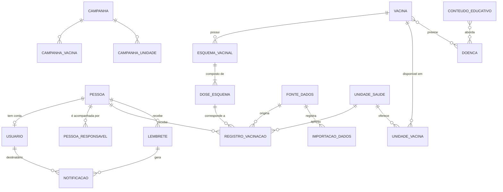

# 05 · Modelo de dados

Script completo: [`banco-de-dados/schema.sql`](banco-de-dados/schema.sql) (MySQL 8, InnoDB, utf8mb4). O script foi extraído do documento original e, em 24/11/2026, **adaptado ao modelo da RNDS** (Registro de Imunobiológico Administrado). As mudanças, o mapeamento campo a campo e a base sintética estão em [11 · Modelo RNDS e base sintética](11-modelo-rnds-e-base-sintetica.md).

> **Foco da implementação:** só a parte do **paciente/cidadão** (blocos 1, 2 parcial, 3, 4 e 5 parcial abaixo). Tabelas de ACS/busca ativa ficam no esquema mas fora do MVP.

## Minimundo (resumo)

O ConectaSaúde Recife é um módulo do Conecta Recife para acompanhar a situação vacinal, incentivar a adesão às campanhas e levar informação de prevenção.

- Cada **pessoa** tem um cadastro e pode ter **conta de usuário**. Menores ou pessoas que precisam de representação têm **responsáveis legais**.
- A **carteira digital** mostra o histórico (vacina, data, fabricante, lote) e as próximas doses, e pode ser exportada em PDF.
- Há um **catálogo de vacinas**, cada uma com um ou mais **esquemas vacinais** (por faixa etária/grupo), compostos de **doses** com ordem e intervalo. Com isso e o histórico, o sistema calcula a situação de cada dose: atrasada, disponível, em dia ou indisponível.
- Os **registros de vacinação** vêm de **fontes oficiais externas**. O ConectaSaúde só consulta, sem substituir o registro oficial.
- **Unidades de saúde** têm endereço, telefone, coordenadas e território, e oferecem determinadas vacinas.
- **Campanhas** têm período, público-alvo, situação, vacinas e unidades participantes.
- **Conteúdo educativo** sobre doenças (dengue, zika, chikungunya, febre amarela, influenza).
- **Lembretes** de doses e campanhas geram **notificações** por canal (app, WhatsApp, SMS, e-mail), com histórico.
- **Profissionais/ACS** atuam em **territórios** e registram **busca ativa**.
- **Gestores** consultam indicadores por território, unidade, vacina, faixa etária e período.
- Toda **importação de dados** é rastreada (fonte, data, quantidade, status).
- O banco de demonstração usa **dados sintéticos**.

## Entidades por domínio

| Domínio | Tabelas | No MVP? |
|---|---|---|
| 1. Pessoas e acesso | `pessoa`, `usuario`, `profissional` | `pessoa`, `usuario` ✅ · `profissional` ⏸ |
| 2. Território | `territorio`, `unidade_saude`, `pessoa_territorio`, `pessoa_responsavel`, `atuacao_territorial`, `unidade_territorio` | `unidade_saude`, `pessoa_responsavel` ✅ · demais ⏸/opcional |
| 3. Vacinação | `vacina`, `doenca`, `vacina_doenca`, `esquema_vacinal`, `dose_esquema`, `fonte_dados`, `registro_vacinacao`, `unidade_vacina` | ✅ todas |
| 3A. Terminologias RNDS | `rnds_imunobiologico`, `rnds_dose`, `rnds_estrategia_vacinacao`, `rnds_via_administracao`, `rnds_local_aplicacao`, `fabricante_imunobiologico` | ✅ |
| Só demonstração | `simulacao_dose_caderneta` (caderneta física simulada) | ✅ (o app não lê) |
| 4. Campanhas | `campanha`, `campanha_vacina`, `campanha_unidade` | ✅ (Should) |
| 5. Acompanhamento e comunicação | `busca_ativa`, `lembrete`, `notificacao` | `lembrete`, `notificacao` ✅ · `busca_ativa` ⏸ |
| 6. Conteúdo e integração | `conteudo_educativo`, `conteudo_doenca`, `importacao_dados` | ✅ |

## Diagrama (núcleo do cidadão)

## Regras de cardinalidade (do minimundo)

1. Uma pessoa pode ter vários registros de vacinação.
2. Uma pessoa pode ter um ou mais responsáveis; um responsável pode acompanhar várias pessoas.
3. Uma vacina pode ter diferentes esquemas vacinais.
4. Cada esquema tem uma ou mais doses previstas.
5. A situação vacinal é derivada das doses previstas + registros + critérios.
6. Unidade × vacina é N:N.
7. Campanha × vacina e campanha × unidade são N:N.
8. Um profissional pode atuar em um ou mais territórios.
9. Um ACS pode fazer vários acompanhamentos de busca ativa.
10. Uma pessoa pode receber vários lembretes e notificações.
11. Os registros oficiais são consultados de fontes externas, não substituídos.
12. O banco de demonstração usa dados sintéticos.

## Pontos de atenção para a implementação

- **Situação da dose não é coluna**: é calculada (view ou serviço) a partir de `dose_esquema.intervalo_apos_anterior`, `esquema_vacinal.idade_minima/maxima`, `pessoa.data_nascimento` e `registro_vacinacao`. ✅ Resolvido em 24/11/2026: idades e intervalos em **dias**; `dose_esquema.idade_recomendada_dias` guarda a idade do calendário.
- **Status "não posso tomar"**: substituído por **Próxima** na tela (D08, 25/11/2026). O enum calculado continua `AINDA_NAO_DISPONIVEL` (ver RN03 em [03](03-requisitos.md)).
- **`registro_vacinacao.id_dose_esquema` é obrigatório**: cada registro externo precisa ser mapeado para uma dose de esquema, e esse é justamente o **de-para**. ✅ Resolvido em 24/11/2026: `id_dose_esquema` aceita `NULL` para registros sem de-para (ex.: esquema especial). O de-para fica em `rnds_imunobiologico.id_vacina` e `dose_esquema.codigo_dose_rnds`.
- **`unidade_vacina`** atende o requisito da gestão de informar mensalmente quais unidades têm cada vacina (`disponibilidade`, `data_atualizacao`).
- **Sala de vacina aberta/fechada**: não existe campo para isso em `unidade_saude`. Em 24/11/2026 entrou `possui_sala_vacina`; `horario_funcionamento` continua em aberto.
- **Aviso de cartão desatualizado**: pode usar `importacao_dados.data_importacao` para mostrar "atualizado em…".
- **Privacidade**: `doenca`/condições clínicas não devem ser ligadas à pessoa; não guardar CID nem condição sensível.
- **Comunicação entre banco nacional e municipal**: ainda a definir (nota do documento original: *"ver provável comunicação entre banco de dados nacional e municipal"*).
